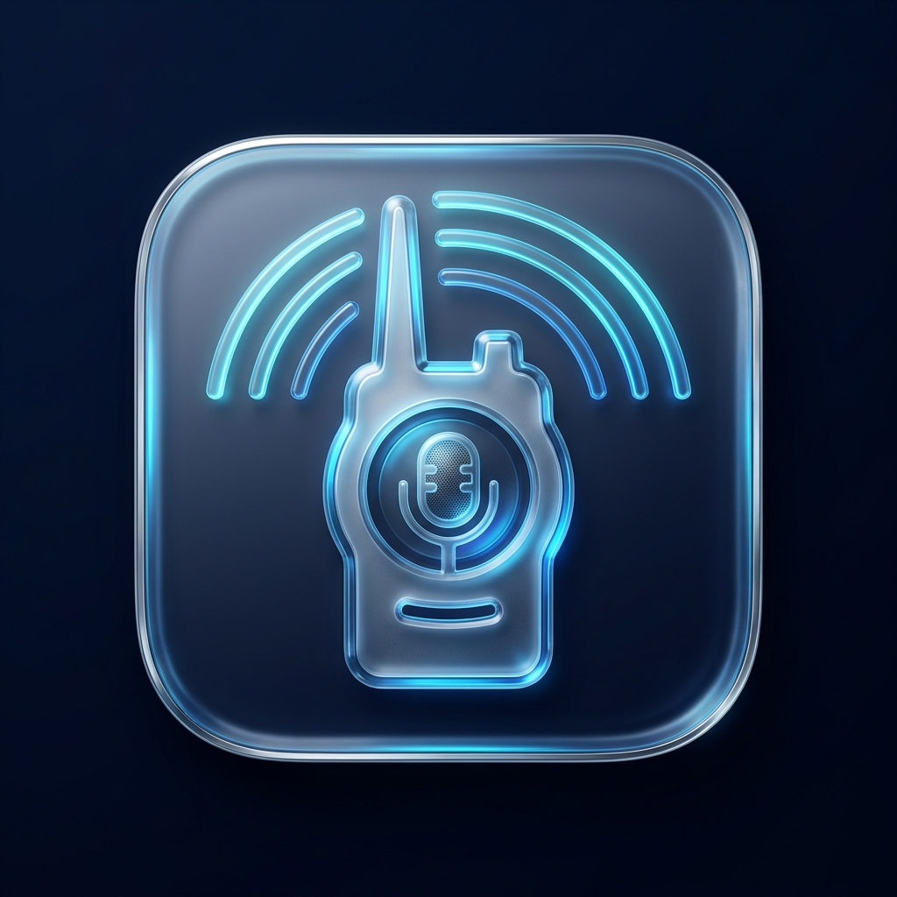
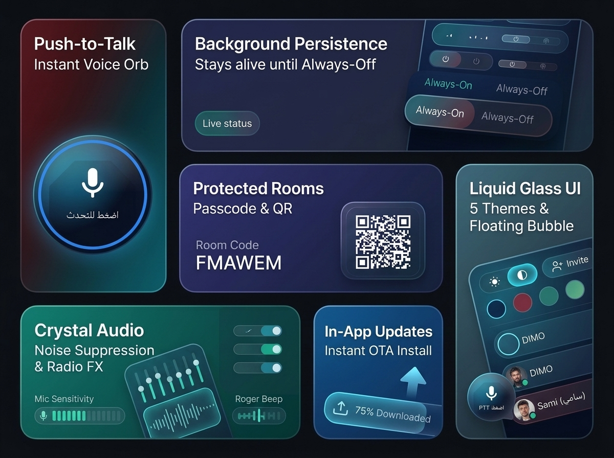

 

# GlassWave

---

  

**تطبيق ووكي توكي سحابي فوري. تصميم زجاجي فاخر. تواصل بلا انقطاع.**  
**Walkie-Talkie, reimagined. Liquid Glass by design. Instant by nature.**

تواصل صوتياً مباشرةً مع أصدقائك ومجموعتك من أي مكان وعلى أي شبكة — بضغطة زر واحدة، أو في وضع **التشغيل الدائم**، مع بقاء الاتصال نشطاً في الخلفية حتى عند إغلاق التطبيق من نافذة التطبيقات المفتوحة، ولا ينقطع إلا عند الضغط على **إغلاق دائم**.

 

  

 

## ✨ المميزات الرئيسية

- **🎙️ الضغط للتحدث (Push-to-Talk):** زر زجاجي فوري يتفاعل حياً مع مستوى صوتك مع موجات متحركة واهتزاز لمسي ونغمة **Roger Beep** القابلة للتخصيص.
- **📡 بقاء دائم في الخلفية:** يستمر الاتصال وسماع المتحدثين حتى أثناء استخدام تطبيقات أخرى أو بعد سحب التطبيق من نافذة التطبيقات المفتوحة، وينقطع فقط عند الضغط على **«إغلاق دائم»** (من التطبيق أو الإشعار).
- **🔐 غرف محمية ورمز QR:** أنشئ غرفتك برمز فريد وكلمة مرور مطلوبة للانضمام، مع مشاركة سريعة وماسح كاميرا QR، وقناة داخلية موحدة لضمان سماع الجميع.
- **🎧 صوت نقي وعزل ضوضاء ذكي:** معالجة صوتية متقدمة لتقليل الضوضاء والصدى، مع خيار فلتر صوت اللاسلكي (**Radio FX**)، تشويش الراديو الواقعي (**Squelch**)، ودعم السماعة الخارجية والأذن والبلوتوث.
- **🎨 تصميم Liquid Glass و5 ثيمات:** تحكّم بدرجة شفافية الزجاج واختر من بين 5 ثيمات لونية، مع **فقاعة تحدث عائمة** فوق التطبيقات ودعم التحدث بأزرار الصوت.
- **🖼️ ملف شخصي وقائمة أعضاء تفاعلية:** محرر مدمج لقص وتكبير وتدوير صورة الملف الشخصي قبل الحفظ، مع عرض اسم وصورة وحالة كل عضو داخل الغرفة.
- **💬 أدوات تواصل سريعة:** نداء عاجل (**Ping**)، إعادة سماع آخر رسالة صوتية، دردشة نصية فورية، ومشاركة الموقع الحالي عبر الخرائط.
- **🚀 تحديث مباشر من داخل التطبيق:** فحص تلقائي للتحديثات وتنزيل شريط التقدم وتثبيت النسخة الجديدة مباشرة من داخل التطبيق.

---

## 📥 التحميل والتثبيت

&nbsp;

&nbsp;

1. حمّل ملف **`glasswave.apk`** من أحد الروابط أعلاه.
2. افتح الملف لتثبيته على جهازك الأندرويد (**Android 7.0+**).
3. سجّل دخولك، أنشئ غرفتك أو انضم برمز الغرفة وكلمة المرور، وابدأ التحدث فوراً.

---

## 📞 للتواصل مع المطور

&nbsp;

